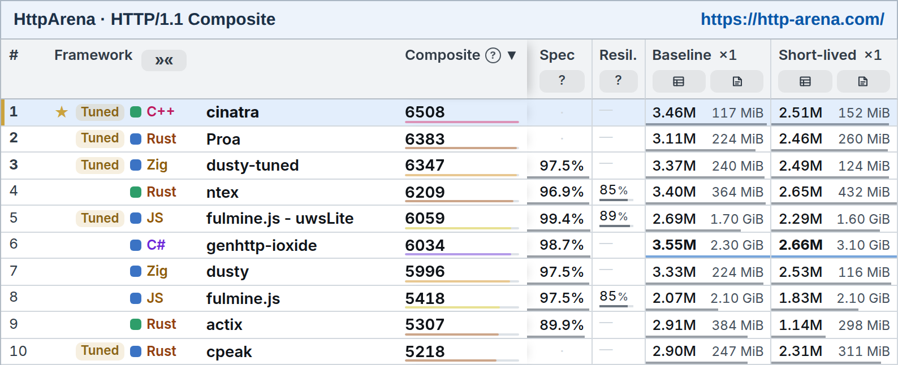

# 6,508 分登顶！国产开源 C++20 框架 Cinatra 拿下 HttpArena HTTP/1.1 综合榜第一

在一台服务器上同时维持 **100 万条 TLS 连接**，每秒处理近 **25 万次请求**，其中 99% 的请求延迟在 **138 微秒**以内。这是国产开源 C++20 框架 Cinatra 在 HttpArena 官方压测中交出的一项成绩。

在 **2026 年 11 月 27 日**更新的 Alpha Round 榜单中，Cinatra 以 **6,508 分**在 **HTTP/1.1 跨语言框架综合榜**的 114 个参评项目中排名第一，也是 C++ 组第一。本次上榜使用 **Tuned** 配置。 [官方榜单](https://http-arena.com) · [Cinatra 成绩详情](https://http-arena.com/frameworks/cinatra/)

*HttpArena HTTP/1.1 综合榜前十名。来源为官方榜单，成绩更新于 2026 年 11 月 27 日。*

---

## HttpArena 是什么？

过去十多年，TechEmpower Framework Benchmarks 一直是开发者比较 Web 框架性能的重要参考。**2026 年 3 月 24 日**，TechEmpower 宣布停止维护。[TechEmpower 停更公告](https://github.com/TechEmpower/FrameworkBenchmarks/issues/10932) · 在这个背景下，由开发者 MDA2AV 发起的独立开源评测平台 **HttpArena** 作为替代诞生了。 [HttpArena 项目仓库](https://github.com/http-arena/HttpArena)

假设两个框架的明文接口都能跑出很高的吞吐。开启 HTTPS、给 JSON 响应加上压缩，或者同时维持大量长连接后，它们的表现还一样吗？HttpArena 从这个问题起步，首次公开了 16 种测试场景。到这次榜单更新，平台已覆盖 **29 种测试场景、223 个参测条目**，涵盖 Web 框架、HTTP 引擎和反向代理。 [HttpArena 发起文章](https://dev.to/fbio_reis_355b87b508598e/why-we-built-httparena-a-better-way-to-benchmark-http-frameworks-j94) · [测试场景](https://http-arena.com/docs/test-profiles/)

## HttpArena 如何保证评测公平？

1. **先验结果，再测速度。** 参加同一场景的实现要按同一份接口规范处理请求。以 JSON 为例，验证脚本每轮随机改变返回条数和计算乘数，再逐条核对响应字段。回显测试则用随机二进制请求体，要求服务端逐字节原样返回。这样能发现把答案写死、跳过实际计算等跑分作弊手法。 [正确性验证](https://http-arena.com/docs/running-locally/scripts/validate/)
2. **平台统一跑分，成绩公开可复核。** 官方在同一台配备 **64 核 AMD Threadripper PRO 3995WX** 的专用物理机上运行容器，按场景统一分配 CPU 核并施加相同负载。Web 框架、HTTP 引擎和反向代理分别排名。参测源码、构建配置、原始数据和评分方法均公开，读者可以追溯榜单分数是怎么算出来的。 [测试硬件](https://http-arena.com/docs/hardware/) · [HttpArena 源码和原始数据](https://github.com/http-arena/HttpArena)

---

## 一张综合榜，测了哪些能力？

HTTP/1.1 综合榜把各计分项归一化后按权重相加。

* **连接与吞吐。** Baseline 和短连接分别看连接复用下的吞吐和频繁建连的开销。异步等待测试让大量请求同时等待，观察框架处理挂起请求的能力。
* **常见业务开销。** JSON 压缩和 JSON over TLS 分别叠加了压缩和加密。固定速率测试以每秒 1 万或 100 万次请求施压，再比较 CPU 开销与延迟。8Gbit 场景以每秒 5 万次请求的目标速率，通过 TLS 接收并原样返回 10 KB 的请求体，测试双向收发。
* **百万长连接。** CON-1M 和 CON-1M-TLS 都维持 **100 万条长连接**，每条连接约每 4 秒发起一次请求，合计目标为 **25 万 RPS**。这个负载接近消息推送和物联网网关，评分同时考虑内存、每请求 CPU 开销与延迟。 [百万长连接测试](https://http-arena.com/docs/test-profiles/h1/connections/)
* **框架完整度。** 框架是否提供路由、中间件、可供应用使用的请求对象和响应构造，也会影响综合分。每缺一项，综合分扣减 2.5%。Cinatra 的完整度是 **4/4**。 [完整度规则](https://http-arena.com/docs/scoring/completeness/)

HTTP/2、HTTP/3、gRPC、WebSocket 和网关各有独立榜单。PostgreSQL 查询与模板渲染也有单独的数据库榜。这样的设置，让读者可以按自己关心的场景比较。 [综合评分方法](https://http-arena.com/docs/scoring/composite-score/)

---

## 跨语言第一，C++ 前五都有谁？

在 HTTP/1.1 跨语言综合榜中，前三名分别是 **Cinatra（C++，6,508 分）**、**Proa（Rust，6,383 分）**和 **dusty-tuned（Zig，6,347 分）**。 [官方榜单](https://http-arena.com)

从同一张包含 Tuned 配置的跨语言榜单筛出 C++ 项目，Cinatra 的综合分比 C++ 组第二名高约 84%。前五名如下：

| C++ 排名 | 框架 | 综合得分 | 跨语言总排名 |
| :---: | :--- | :---: | :---: |
| **1** | **Cinatra (Tuned)** | **6,508** | **#1** |
| 2 | libuvcpp | 3,537 | #25 |
| 3 | Cutelyst | 3,206 | #28 |
| 4 | Drogon | 3,080 | #31 |
| 5 | userver | 2,069 | #54 |

Cinatra 在各测试场景中的实测结果： [Cinatra 成绩详情](https://http-arena.com/frameworks/cinatra/)

| 测试场景 | 并发连接数 | 每秒请求数 (RPS) | P99 延迟 | 内存占用 |
| :--- | :---: | :---: | :---: | :---: |
| **HTTP/1.1 Baseline** | 4,096 | **3,455,004** | 1.69 ms | 117 MiB |
| **JSON 压缩 (Gzip)** | 4,096 | **921,833** | 13.20 ms | 231 MiB |
| **JSON over TLS** | 4,096 | **1,519,177** | 70.08 ms | 281 MiB |
| **百万明文长连接 (CON-1M)** | 1,000,000 | **249,999** | **122 µs** | 14.4 GiB |
| **百万 TLS 长连接 (CON-1M-TLS)** | 1,000,000 | **249,968** | **138 µs** | 27.7 GiB |

---

## 认识一下 Cinatra

**Cinatra** 是一个采用 **MIT 许可证**的现代化、跨平台、**Header-Only** C++20 HTTP 框架，由国内开源社区 **PureCpp** 创始人祁宇创建和长期维护。 [PureCpp 社区介绍](https://purecpp.cn/about.html)

Cinatra 追求极致吞吐，也注重现代 C++ 开发的工程体验：

* **现代协程架构。** 原生基于 C++20 无栈协程，用接近同步的写法编写高并发异步代码。
* **开箱即用。** 引入头文件即可接入，同时提供服务端与客户端，支持 HTTP/1.1、HTTPS、WebSocket 以及 SSE（Server-Sent Events）。
* **场景丰富。** 可以用它构建高并发微服务 API，为现有 C++ 核心业务挂载轻量管理端口，也可以用协程客户端流式调用大模型（LLM）接口。 [快速示例](https://github.com/qicosmos/cinatra#快速示例)

感谢 HttpArena 维护者搭建了公开、严苛且可复核的竞技场，也感谢每一位为 Cinatra 贡献代码和提交 Issue 的社区开发者。

如果你正在寻找一个兼顾**现代 C++20 写法**与**高吞吐**的框架，欢迎前往 GitHub 体验 Cinatra，点亮一颗 **Star** 支持国产开源，也欢迎带着你的真实业务场景来社区交流！ [Cinatra GitHub 仓库](https://github.com/qicosmos/cinatra) · [PureCpp 社区聊天室](https://purecpp.cn/chatroom.html)
